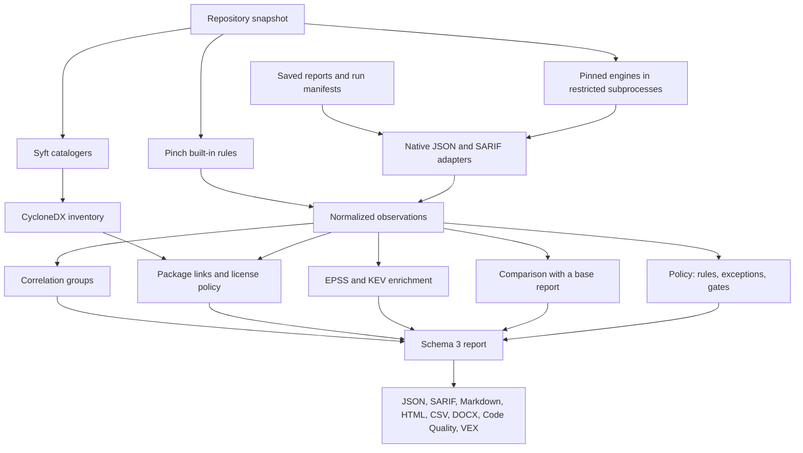

# CRAB architecture

CRAB processes one local repository snapshot per scan. The same core serves three interfaces: the `scan` command, the `ci` runner and the self-hosted server with its workers. The core uses only the Python standard library. It never depends on the WebUI, an external API or a database.

## Execution modes

| Mode | Entry point | Output |
|---|---|---|
| CLI | `crab-risk-scan scan DIRECTORY` | Report files or stdout, exit status from the policy |
| Runner | `crab-risk-scan ci DIRECTORY` | Artifact folder, CI summary and annotations, optional upload to a server |
| Server | `crab-risk-scan serve` and `crab-risk-scan worker` | REST API, WebUI, scan history, triage, jobs, schedules and dashboards |

Workers run the `scan` command in a subprocess, so every mode produces the same report for the same inputs.

## Discovery and execution

Built-in checks read regular UTF-8 files of up to 1 MiB and skip symlinks and common generated directories. Missing optional parsers and unparseable files count as coverage errors.

`--engines auto` runs each installed engine whose file types are present and records the others as skipped. `--engines all` treats a missing engine as a failure. Engines are found through `--engine-path`, then `CRAB_ENGINE_DIR`, then absolute `PATH` entries. An executable inside the scanned directory is always rejected. Each engine runs with a restricted environment, a private working directory and home, closed standard input, a timeout and, on POSIX, resource limits. Engines write their reports to a private directory outside the target. Offline flags are the default. `crab-risk-scan db update` is the only command that fetches vulnerability databases. Containers add network isolation.

`crab-risk-scan engines install` downloads the versions pinned in `crab_risk_scan/engines.lock.json` and verifies each SHA-256 digest before use. Saved reports enter through the same adapters as engine output. They are bounded at 16 MiB each, and inventories at 32 MiB.

## Observations, groups and inventory

| Entity | Identity and purpose |
|---|---|
| Import | Ordinal, producer, origin (engine, report or manifest), version, rule pack and status. Skipped and failed entries carry a reason. |
| Observation | Producer, rule or advisory, category, kind, normalized and original severity, location and a line-independent fingerprint. Optional evidence includes CWE, CVSS, fixed version, risk type, EPSS, KEV, package, image digest and help URI. |
| Group | Observation fingerprints, revision, mapping version and highest severity |
| Component | A CycloneDX component with licenses, direct-dependency status and linked observations |

Source fingerprints hash the producer, rule, path, the whitespace-normalized content of the flagged lines, an occurrence index and a stable identity. Inserting unrelated lines therefore keeps fingerprints and their exceptions. Credential fingerprints (secret findings and hard-coded password rules) keep only a 16-bit tag of that content: a changed secret gets a new fingerprint, but the tag cannot confirm a guessed secret. Dependency fingerprints use the package, advisory, manifest and image scope. Report-supplied paths are checked lexically and never resolved, so a UNC path in an imported report cannot make the host contact another machine.

Exact duplicates within a producer share an observation. Rule equivalence maps connect findings from different producers only when they describe the same file and complete byte extent. Dependency grouping requires the same canonical package URL, installed version and artifact scope. Equal advisory IDs and OSV aliases connect transitively within that scope. Image findings carry a validated sha256 digest and never become checkout annotations.

## Policy and reporting

Policy evaluation runs in this order: rule profile (disabled rules, severity overrides), license findings from the inventory, exceptions, comparison with a base report, then gates. Gates cover the severity threshold, secrets, malicious packages, KEV, EPSS, licenses, per-severity counts and new findings only. Exceptions carry a status (accepted, false positive or not affected with a VEX justification), a reviewer, a reason, an optional ticket and an optional expiry. Expired exceptions stop suppressing. Unmatched exceptions are reported as stale.

Exit status 2 takes precedence when coverage is incomplete. Exit status 1 means the policy failed, and 0 means it passed within the measured coverage. Renderers turn one schema 3 report into every export format. See [reporting](reporting.md).

## Server

The server is an optional extra built on FastAPI and SQLAlchemy, with SQLite by default and PostgreSQL optional. It stores uploaded and worker-produced reports, findings, exceptions, jobs, schedules, users, memberships and API tokens. Administrators manage everything. Project maintainers triage, upload, run jobs and manage schedules, and viewers read. Workers lease jobs, send heartbeats and are requeued when a lease expires. A cron scheduler enqueues due scans with a compare-and-set, so several API instances never duplicate a run. See [server](server.md) and [API](api.md).

[Roadmap](roadmap.md) · [Integrations](integrations.md) · [Reporting](reporting.md) · [CI](ci.md) · [Server](server.md) · [WebUI](webui.md) · [Language coverage](coverage.md) · [SARIF specification](https://docs.oasis-open.org/sarif/sarif/v2.1.0/sarif-v2.1.0.html)
