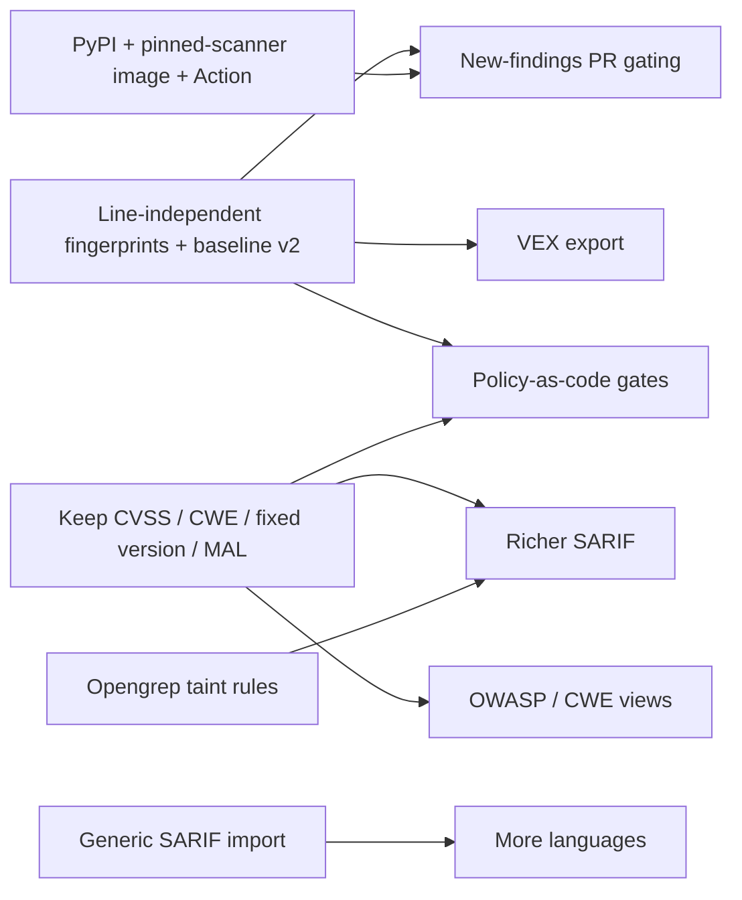

# Gap analysis: CRAB versus SonarQube paid plans

Reviewed on 20 November 2026 against commit `372f4dd` (v0.2.0). The baseline is SonarQube Server 2026.5 Developer, Enterprise and Data Center, the Advanced Security add-on, and SonarQube Cloud Team and Enterprise. Sources: [editions matrix](https://docs.sonarsource.com/sonarqube-server/discovering/sonarqube-server-editions), [Server pricing](https://www.sonarsource.com/plans-and-pricing/sonarqube/), [Advanced Security](https://docs.sonarsource.com/sonarqube-server/advanced-security/introduction), [dependency risks](https://docs.sonarsource.com/sonarqube-server/advanced-security/reviewing-and-fixing-dependency-risks.md) and [Cloud plans](https://docs.sonarsource.com/sonarqube-cloud/administering-sonarcloud/managing-subscription/subscription-plans).

At the reviewed commit, the local suite ran 21 tests on Windows with Python 3.14 and passed. The six tests that require real external scanners were skipped.

## 1. Planned features that are still missing

The roadmap lived in commit `3e89065` (`docs/coverage.md` and the milestones in `docs/architecture.md`). Commit `a5ffe8a` removed it. Three references still point to it: the README "Implemented or planned" column, `AGENTS.md` and `.agents/skills/integrate-report/SKILL.md`.

| Planned item | Status | Evidence |
|---|---|---|
| Python source and sink rules in the Opengrep pack | Missing | `opengrep-v1.yml` covers JavaScript, TypeScript and Rust only |
| Python fixtures for aliased or rebound `ssl` names | Missing | `rules.py` matches the literal `ssl` name |
| JavaScript workspace package deduplication fixture | Untested | No fixture |
| Separate TypeScript framework and cross-file coverage records | Missing | The report has no such field |
| Rust unsafe and FFI rules, advisory counts per module | Missing | The pack contains `transmute` only |
| SQL injection rules in host languages | Missing | Only `CRAB-SQL-001` (GRANT to PUBLIC) |
| Mojo Python-interop inventory | Missing | None |
| HTML templates, inline scripts and host-file mapping | Missing | Standalone markup only |
| Bash Opengrep rules and here-document, shebang-only and intentional-splitting fixtures | Missing | Four ShellCheck codes and one live fixture |
| PowerShell dynamic invocation and remoting | Missing | The exporter selects one rule |
| Terraform provider field, explicit unknown status for unresolved modules and variables, Kubernetes | Missing or untested | Terraform fixtures only |
| Inventory gaps for missing catalogers, Terraform module, PowerShell Gallery and Mojo identities | Missing | `package_url()` knows npm, PyPI and Cargo |
| Machine-readable rule-pack metadata | Partial | Prose in `coverage.md` only |
| Curated cross-engine mappings | Partial | One pair in `SOURCE_EQUIVALENTS` |
| Producer version required for every input | Partial | Enforced only through `--run-manifest` |
| Package URL joins | Fragile | Exact string comparison without qualifier or PyPI name normalization |

## 2. Reproduced defects

| Probe | Observed result |
|---|---|
| Suppress a finding, insert one line above it and run again | The fingerprint changes, the suppression is lost and the exit status changes from 0 to 1 |
| Gitleaks `aws-access-token` finding with `--fail-on high` | Severity `unknown`, exit status 0 |
| Trivy finding with `CVSS`, `CweIDs` and `FixedVersion` | None of these fields is retained |
| OSV malicious-package advisory `MAL-*` | Severity `unknown` |
| CycloneDX inventory with `licenses` and `dependencies` | Only name, version and package URL are retained |
| SARIF output | No `tool.driver.rules`, no `security-severity`, secrets use level `note`, no columns or revision |

## 3. Paid SonarQube features and the work CRAB needs

Priority scale: **P0** fixes correctness or an adoption blocker, **P1** high-value parity, **P2** medium value, **P3** optional.

### Code security

| SonarQube feature (tier) | CRAB at the reviewed commit | Work to build | Priority |
|---|---|---|---|
| 40 or 48 languages (Developer or Enterprise) | About 10 languages with one to four rules each | Generic SARIF 2.1.0 importer for gosec, SpotBugs with FindSecBugs, Clang Static Analyzer, ESLint and a user's own CodeQL results | P0 |
| Secrets detection and custom patterns (Developer or Enterprise) | Gitleaks import. Custom Gitleaks configurations already work. | Severity per Gitleaks rule ID, `gitleaks git` mode for history, optional TruffleHog verification that is disabled by default | P0 |
| Cross-file injection (taint) analysis (Developer) | Pattern matching only | Opengrep taint rules with `taint_interfile: true`, run with `--enable-interfile`. The pinned Opengrep 2.0.0 binary [ships this capability](https://github.com/opengrep/opengrep/releases). Export data-flow paths as SARIF `codeFlows`. Start with Python, JavaScript and TypeScript. | P1 |
| IaC breadth: CloudFormation, Kubernetes and Helm, ARM and Bicep, Ansible, GitHub Actions | Checkov tested on Terraform only | Fixtures for each Checkov framework, zizmor for GitHub Actions, equivalence pairs such as `CRAB-CTR-001` and `CKV_DOCKER_8` | P1 |
| Security hotspots versus vulnerabilities (used by quality gates) | Review rules fail the gate like vulnerabilities | A `kind: review` category left out of the default gate | P1 |
| Custom security-engine configuration (Enterprise) | Trusted external rule packs | Source, sink and sanitizer template with an `opengrep --test` harness | P2 |

### Dependencies and supply chain

Advanced Security requires SonarQube Server Enterprise or higher. On SonarQube Cloud it is a separate subscription for Team or Enterprise.

| SonarQube feature | CRAB at the reviewed commit | Work to build | Priority |
|---|---|---|---|
| CVSS, CWE and fixed versions | Dropped | Retain `CVSS`, `CweIDs`, `FixedVersion` and GitHub advisory `cwe_ids` | P0 |
| Malicious packages always rated Blocker | Severity `unknown` | Treat every `MAL-*` advisory as a critical malicious-package risk | P0 |
| EPSS (exploit probability) and CISA KEV (known exploited) severity | None | Load dated EPSS and KEV files offline, with an optional SonarQube-style severity ladder | P1 |
| License policy | Ignored | Allow and deny policy over SPDX license expressions, or import `osv-scanner --licenses` | P1 |
| Direct and transitive dependency chains | The CycloneDX `dependencies` graph is ignored | Build chains from the CycloneDX graph | P1 |
| VEX export with justifications | Reviewer and reason only | CycloneDX VEX or OpenVEX generated from the baseline | P1 |
| SPDX and XML inventories | CycloneDX JSON only | Pass through the other Syft output formats | P2 |
| Reachability analysis | None | Import govulncheck or OSV-Scanner call-analysis results | P3 |

### CI and developer workflow

| SonarQube feature | CRAB at the reviewed commit | Work to build | Priority |
|---|---|---|---|
| Issue lifecycle: Accepted, Safe, False positive, reopen | Exact-fingerprint suppressions | Fingerprints that do not depend on line numbers. Baseline v2 with VEX-compatible statuses, expiry date, ticket link and a report of stale entries. | P0 |
| Security alerts in GitHub and GitLab (Server Developer, Cloud Enterprise) | Minimal SARIF | `rules[]` with help text, `security` and `cwe` tags and `properties.security-severity`, plus provenance and run identity. [GitLab SARIF ingestion](https://docs.gitlab.com/user/application_security/detect/sarif/) requires `rules[].id` and a job that exits 0, so the reviewed SARIF output is likely to be dropped (inferred, not tested). Also emit GitLab Code Quality JSON, which works on [GitLab Free](https://docs.gitlab.com/ci/testing/code_quality.html). | P0 |
| Pull request and branch analysis, merge blocking (Developer) | Exit statuses only | GitHub Action, GitLab template and pre-commit hook built on a container image with pinned scanners that writes the run manifest. Bitbucket and Azure DevOps later. | P0 |
| Quality gate on new findings only | None | `--new-since BASE.json` with a Markdown summary for the pull request | P1 |
| Custom quality gates and prioritized rules (Developer or Enterprise) | One severity threshold | Policy file with conditions on KEV, available fixes, licenses, new findings, counts and must-fix rules | P1 |
| Quality profiles (Developer) | None | Enable or disable rules and override severities | P1 |
| Monorepo support (Enterprise) | One snapshot per run | Subproject map with CODEOWNERS ownership | P2 |
| MCP server and IDE integration (Developer) | None | Read-only MCP server over the report | P3 |

### Governance and reporting

| SonarQube feature (Enterprise) | CRAB at the reviewed commit | Work to build | Priority |
|---|---|---|---|
| Portfolios, dashboards and history | Stateless | Export to DefectDojo and OWASP Dependency-Track instead of building a server | P1 |
| Compliance reports: OWASP Top 10, ASVS, CWE Top 25, PCI DSS, STIG, OWASP LLM Top 10, MASVS, EU CRA | CWE data is discarded | Versioned mappings from CWE to each standard, a static HTML report and a CRA bundle with SBOM, VEX and findings. CRA reporting obligations have applied since 11 September 2026 ([European Commission](https://digital-strategy.ec.europa.eu/en/policies/cra-summary)). | P2 |
| Regulatory and PDF reports, audit logs | None | Signed reports and attestations with Sigstore or in-toto | P3 |

### Non-goals

- Code-quality metrics: bugs, code smells, coverage, duplication and technical debt.
- Architecture analysis and MISRA.
- Advanced SAST inside dependency code.
- AI CodeFix and the SonarQube agent products (Remediation Agent, Hunter Agent, Sonar Vortex).
- Server administration: SAML, SCIM, high availability and Data Center.
- Jira and Slack integrations. DefectDojo covers Jira.
- Legacy languages: COBOL, ABAP, RPG, PL/I, JCL, VB6, Apex, Gosu and DataWeave.

### Open-source adoption blockers without a SonarQube equivalent

- No PyPI release.
- The version is hard-coded in both `pyproject.toml` and `reporting.py`.
- No published JSON Schemas for the report, baseline and run manifest.
- CI runs on Linux only.
- The roadmap document was removed.

## 4. Build order

## 5. Licensing cautions

- **CodeQL:** proprietary terms that permit free use only on open-source code under an approved license. Import its results and never bundle it.
- **Semgrep and Opengrep rules:** the Semgrep registry rules moved to a restrictive license in December 2024. The `opengrep-rules` fork is LGPL-2.1 with a [Commons Clause](https://raw.githubusercontent.com/opengrep/opengrep-rules/main/LICENSE) that forbids selling, and it is labelled for research, testing and benchmarking. CRAB should write its own Apache-2.0 rules.
- **TruffleHog (AGPL) and hadolint (GPL):** acceptable when CRAB only reads their output from a separate process. TruffleHog verification authenticates with the secrets it found, so keep it disabled by default.

## 6. Review method

The findings were checked against the repository source, local CLI probes and the primary documentation linked above. An independent model review of the draft was folded in:

- **Accepted:** stable finding identity first, retained producer data as P0 ahead of EPSS, KEV and compliance views, secret severity per Gitleaks rule, GitLab Code Quality output for Free-tier projects, `security-severity` on `rules[]`, the CodeQL and TruffleHog cautions and package URL normalization.
- **Rejected:** "Opengrep cross-file taint is unverified", because the Opengrep 2.0.0 release notes and documentation confirm it, and "`opengrep-rules` is plain LGPL", because its license adds a Commons Clause.

## 7. Status in 0.3.0

Version 0.3.0 implements the four phases of the [roadmap](roadmap.md). Every defect in section 2 has a regression test.

| Gap | Status in 0.3.0 |
|---|---|
| Line-dependent fingerprints, exceptions lifecycle | Closed: content-based fingerprints, exceptions v2 with status, VEX justification, expiry, ticket, stale and expired reporting |
| Secret severity, malicious packages, dropped CVSS, CWE and fixed versions | Closed |
| EPSS and KEV prioritization, license policy, direct dependencies | Closed: offline EPSS and KEV files, `CRAB-LIC-001` findings from SBOM licenses, `direct` from the dependency graph |
| Thin SARIF, GitHub and GitLab ingestion, GitLab Code Quality | Closed: rule metadata, `security-severity`, CWE tags, provenance, synthetic locations for image findings, Code Quality JSON |
| Generic SARIF import | Closed |
| Custom quality gates, profiles, new-code gating | Closed: policy v1 with gates, rule disabling, severity overrides and `--new-since` |
| Review signals versus vulnerabilities | Closed: `kind: review` with the `include_review` policy switch |
| Turnkey engines, offline databases | Closed: `engines install` with SHA-256 verification, `db update`, orchestrated offline scans, scanner image |
| PR decoration and CI integration | Closed: `ci` runner with GitHub, GitLab, Azure Pipelines and Jenkins support and templates |
| VEX, SPDX | Closed |
| Portfolios, dashboards, history | Closed by the self-hosted server: projects, scan history, comparison, organization and project dashboards |
| PDF and regulatory reports | Partly closed: DOCX technical and executive reports with custom templates. No OWASP, PCI or CRA compliance mapping yet. |
| JSON Schemas, single-sourced version, Windows and macOS CI, roadmap | Closed. PyPI publishing needs a trusted publisher on PyPI before the first tag. |
| Opengrep taint packs, reachability, monorepo subprojects, MCP server, signed report attestations | Open, listed under "Later" in the roadmap |
| Planned language and rule items in section 1 | Open. The orchestrated Checkov run now selects Terraform, Kubernetes, Helm, CloudFormation, ARM, Bicep, Dockerfile and GitHub Actions by file type, but only Terraform has a live fixture. |

[Language coverage](coverage.md) · [Architecture](architecture.md) · [Integrations](integrations.md)
