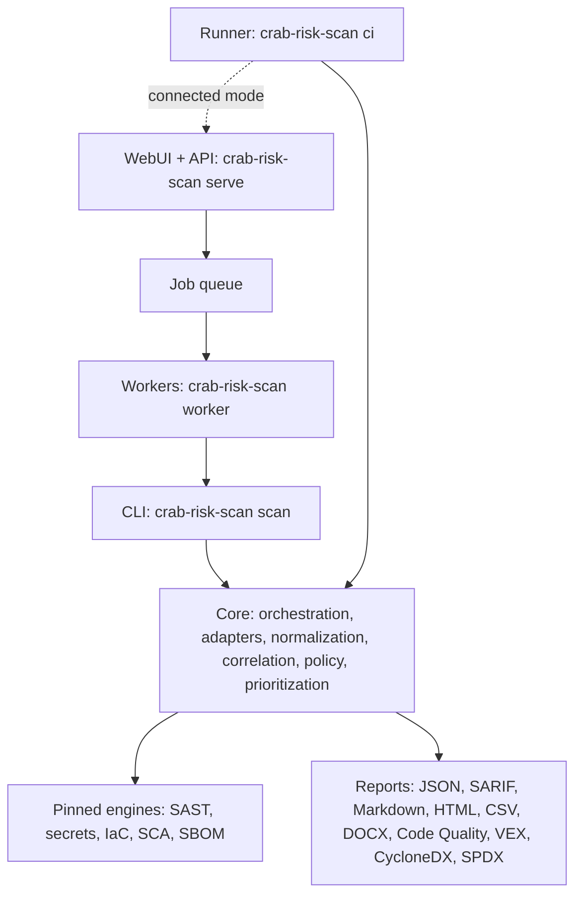

# CRAB roadmap

CRAB is an offline-first, modular security scanning platform: one scanning engine, three execution modes and several report formats. The CLI, the CI runner and the self-hosted WebUI all drive the same core. The core never depends on the WebUI, an external API or a database server. Version 0.3.0 implements phases 1 to 4. The [gap analysis](gap-analysis.md#7-status-in-030) lists what remains open.

## Decisions

| Topic | Choice | Reason |
|---|---|---|
| Command name | `crab-risk-scan` with subcommands `scan`, `ci`, `serve`, `worker` | Bare `crab` and "Crab-Runner" already identify other projects |
| Python | 3.11 or newer | Python 3.10 reached end of life in October 2026. Current FastAPI and SQLAlchemy releases require 3.11. |
| Core dependencies | Standard library only, with `argparse` for the CLI | Offline and air-gapped installation stays a single wheel |
| Optional extras | `docx`, `server`, `postgres`, `pinch` | Each interface pulls its own dependencies |
| Policy and exception files | JSON, versioned | Matches the run manifest and keeps one input convention |
| Server | FastAPI with SQLAlchemy. SQLite by default, PostgreSQL optional. React and TypeScript UI built with Vite. | Matches the planned stack. One process for small installations. |
| Workers | The stock scanner image runs `crab-risk-scan worker`, which calls the CLI in a subprocess | The scan path is identical in every mode. Workers need no server dependencies. |
| Offline operation | Engines run with offline flags by default. `crab-risk-scan db update` is the only networked preparation step. | Air-gapped scans with locally updated vulnerability databases |
| Isolation | Restricted environment, private working directory, timeouts and POSIX resource limits. Containers add `--network none` or an internal network. | Third-party engines parse untrusted repositories |

## Module layout

| Logical module | Location |
|---|---|
| crab-core | `crab_risk_scan/pipeline.py`, `engines.py`, `reporting.py`, `triage.py`, `enrich.py` |
| crab-adapters | `crab_risk_scan/adapters.py`, `engines.lock.json`, `engines/` |
| crab-cli | `crab_risk_scan/__main__.py` |
| crab-runner | `crab_risk_scan/runner.py`, `integrations/` |
| crab-api | `crab_risk_scan/server/`, `crab_risk_scan/worker.py` |
| crab-web | `web/` (built into `crab_risk_scan/server/static/`) |
| crab-reporting | `crab_risk_scan/reports/` |
| crab-sbom | `crab_risk_scan/sbom.py` |
| crab-policies | `crab_risk_scan/policy.py`, `crab_risk_scan/schemas/` |
| deployments | `deployments/docker/`, `compose.yaml` |

## Phase 1: scanning engine and CLI

| Deliverable | Acceptance |
|---|---|
| Report schema 3 | Every finding carries category, kind, CWE, CVSS, fixed version and risk type when a producer supplies them. A JSON Schema validates real output. |
| Line-independent fingerprints | Inserting a line above a finding keeps its fingerprint and its exception |
| Engine orchestration | `scan` runs installed, applicable engines with offline flags and records complete, partial, failed or skipped status for each |
| Generic SARIF import | SARIF 2.1.0 from any producer becomes normalized findings |
| Policy v1 and exceptions v2 | Gates for severity, secrets, malicious packages, KEV, EPSS, licenses, counts and new findings. Exceptions carry status, expiry and ticket. Stale and expired entries are reported. |
| Prioritization | Offline EPSS and KEV files enrich findings and drive gates |
| Reports | JSON, SARIF with rule metadata, Markdown, standalone HTML, CSV, DOCX, GitLab Code Quality and CycloneDX VEX |
| SBOM | CycloneDX and SPDX inventories from one Syft run, license policy findings |
| Offline databases | `db update` prepares Trivy and OSV databases. Scans make no network requests. |

## Phase 2: container and CI runner

| Deliverable | Acceptance |
|---|---|
| Runner | `crab-risk-scan ci` detects GitHub Actions, GitLab CI, Azure Pipelines and Jenkins, writes an artifact folder, a job summary and annotations, and exits with the policy result |
| Baseline comparison | `--new-since` marks new and fixed findings and can gate on new findings only |
| Scanner image | Pinned engines installed with checksum verification, non-root user, offline by default |
| CI templates | GitHub Action, GitLab template with separate scan and gate jobs, Azure DevOps steps, Jenkinsfile, pre-commit hook |
| Connected mode | The runner uploads the report and SBOM to a CRAB server when given a URL and token |

## Phase 3: WebUI and API

| Deliverable | Acceptance |
|---|---|
| Deployment | `docker compose up -d` starts the API with the WebUI, one or more workers and optional PostgreSQL |
| Projects and history | Projects, scan history, upload from runners and scan jobs |
| Findings | Filtering, triage into exceptions and export of the exceptions file for CI |
| Comparison | New, fixed and unchanged findings between two scans |
| Reports | Every report format downloadable per scan |

## Phase 4: advanced reporting and centralized runners

| Deliverable | Acceptance |
|---|---|
| DOCX templates and executive summaries | Technical and executive templates, plus custom DOCX templates |
| RBAC | Administrators and project members with maintainer or viewer roles |
| Distributed workers | Leased jobs, heartbeats and automatic requeue after a lost worker |
| Scheduled scans | Cron schedules per project without duplicate runs across API instances |
| Organization dashboards | Severity, category, policy and trend views across projects |

## Migration from 0.2

`scan` becomes the full scan and absorbs `collect`. Pass `--engines none` to import saved reports without running engines. Reports move to schema 3. Fingerprints change, so regenerate suppressions as exceptions v2 files. Python 3.10 is no longer supported.

## Later

These items from the gap analysis follow the four phases: Opengrep taint rule packs, reachability, monorepo subprojects, an MCP server, signed report attestations and compliance mappings for OWASP, PCI DSS and the EU Cyber Resilience Act.

[Gap analysis](gap-analysis.md) · [Architecture](architecture.md) · [Integrations](integrations.md)
